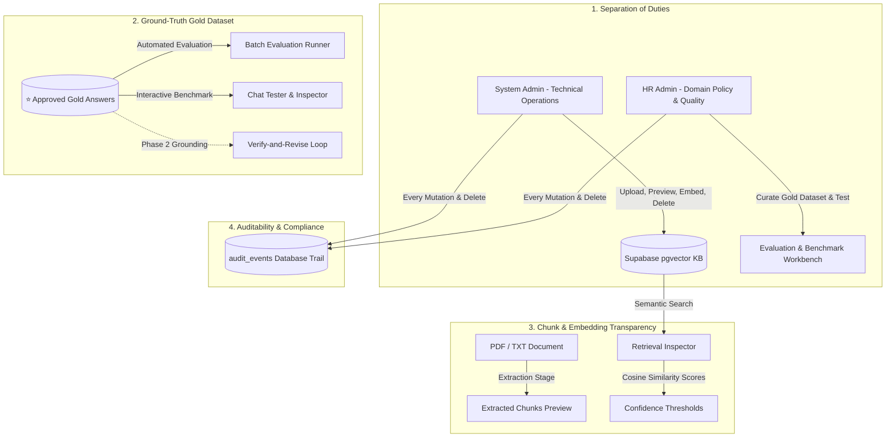

# Pulse360 RAG Governance, Auditability, and Accountability Guide

This document establishes the official governance, quality oversight, and compliance architecture for the **Pulse360 FAQ Retrieval-Augmented Generation (RAG) Assistant** within the Pulse360 HR Review Analytics Platform.

---

## 1. Governance Architecture Overview

The Pulse360 FAQ Assistant operates on an enterprise knowledge foundation powered by **Supabase `pgvector`** semantic indexing and dedicated Python retrieval microservices. To ensure that AI-generated policy guidance remains accurate, auditable, and strictly aligned with company standards, the platform implements four pillars of governance:

---

## 2. Role-Based Separation of Duties

To safeguard company knowledge integrity while giving HR domain experts direct visibility into assistant behavior, Pulse360 enforces strict role-based access tiers:

| Governance Tier | Allowed Roles | Capabilities & Responsibilities | Route Protection |
|---|---|---|---|
| **RAG Mutation Tier** (`RAG_MUTATION_ROLES`) | `SYSTEM_ADMIN` | • Upload FAQ source documents (PDF, TXT, Markdown up to 4 MB) • Review chunk preview boundaries and approve embedding • Permanently delete documents and purge vector embeddings | `/api/system-admin/rag/preview` `/api/system-admin/rag/commit` `/api/system-admin/rag/documents/[id]` |
| **RAG Policy & Tool Tier** (`RAG_TOOL_ROLES`) | `SYSTEM_ADMIN` `HR_ADMIN` | • View committed knowledge base source documents • Manage Ground-Truth Approved Answers (Gold Dataset) • Test queries in the Chat Tester & Inspector Sandbox • Inspect retrieved vector chunks and cosine similarity ranks • Execute batch evaluation and scoring runs | `/api/system-admin/rag/documents` `/api/system-admin/rag/samples/*` `/api/system-admin/rag/test-query` |

---

## 3. When and How the System Uses the Gold Dataset

The **Approved Answers (Gold Dataset)** represents the company's verified ground truth. The system uses it across three distinct operational phases:

### Phase A: Interactive Benchmarking in Chat Tester
- HR Administrators and System Administrators can click **"⭐ Test with Gold Sample"** or select a benchmark query directly from the Chat Tester.
- The assistant retrieves relevant vector chunks and generates an answer.
- The Chat Tester renders a **Ground Truth Benchmark Card** comparing the generated response side-by-side with the approved standard to allow instant verification of factual alignment.

### Phase B: Automated Offline Batch Evaluation
- The evaluation engine runs test questions through the RAG pipeline and scores output across three dimensions:
  1. **Embedding Cosine Similarity (50% weight)**: Vector distance between generated text and approved standard.
  2. **Factual Coverage (50% weight)**: LLM-as-a-judge assesses whether all required policy points are present.
  3. **Contradiction Penalty**: Any factual contradiction caps the final score.
- **Leave-One-Out Isolation**: When evaluating a specific sample, that sample is excluded from the retrievable evidence pool to prevent circular self-grading.

### Phase C: Runtime Verification (Phase 2 Loop)
- In production, approved answers act as few-shot exemplars and style guides. If an answer scores below the 75% confidence threshold, a verifier re-generates the response guided by approved company standards.

---

## 4. Chunk Extraction Preview and Embedding Transparency

To eliminate "black box" retrieval, Pulse360 provides full visibility into how raw documents are transformed into vector embeddings:

### 1. Document Ingestion Chunk Preview
- When a PDF, TXT, or Markdown file is uploaded, the parser extracts discrete machine-readable text chunks and page numbers.
- Before vector embedding begins, administrators can open the **Extracted Chunks Preview Modal** to review exact text segments, character counts, and page boundaries.

### 2. Retrieval Inspector with Vector Similarity Scores
For every query tested in the sandbox, the **Chunk & Retrieval Inspector** displays:
- **Vector Cosine Similarity Score** (`0.0000` to `1.0000` / `0% - 100%`).
- **Confidence Threshold Bands**:
  - 🟢 **High Match (`>= 80%`)**: Strong semantic alignment and direct factual grounding.
  - 🟡 **Moderate Match (`60% - 79%`)**: Contextually relevant; reviewed for completeness.
  - ⚪ **Low Match (`< 60%`)**: Distant relevance; flagged for potential review.
- **Document Metadata**: Source filename, document UUID, page number tag (e.g., `Page 3`), and chunk UUID.
- **Full-Text Chunk Viewer**: An expandable modal displaying the complete extracted passage without truncation.

---

## 5. Audit Logging and Accountability

Every action that modifies knowledge sources or golden samples is recorded in the platform's `audit_events` database:

| Action Code | Trigger Event | Metadata Captured |
|---|---|---|
| `RAG_SAMPLE_CREATED` | New approved answer added to Gold Dataset | `sampleId`, `question`, `category`, `actorId` |
| `RAG_SAMPLE_UPDATED` | Approved answer edited or updated | `sampleId`, `question`, `category`, `actorId` |
| `RAG_SAMPLE_DELETED` | Approved answer removed from Gold Dataset | `sampleId`, `actorId` |
| `RAG_SAMPLES_IMPORTED` | Bulk CSV or JSON dataset import executed | `count`, `actorId` |
| `RAG_DOCUMENT_DELETED` | Source document and all vector chunks purged | `documentId`, `filename`, `chunksCount`, `actorId` |

---

## 6. Pre-Built Benchmark Datasets

Pulse360 provides two pre-configured Golden Datasets ready for import in the **⭐ Approved Answers** tab:

1. [`docs/samples/pulse360_customer_faq_gold_dataset.csv`](../samples/pulse360_customer_faq_gold_dataset.csv) & [`.json`](../samples/pulse360_customer_faq_gold_dataset.json): Customer and platform-focused FAQ benchmarks (pricing, tiers, bulk import, privacy, roles, compliance).
2. [`docs/samples/pulse360_employee_review_gold_dataset.csv`](../samples/pulse360_employee_review_gold_dataset.csv) & [`.json`](../samples/pulse360_employee_review_gold_dataset.json): Internal employee onboarded FAQ benchmarks (360 review cycle phases, nominations, peer review confidentiality, scoring criteria, consultations, improvement plans).
